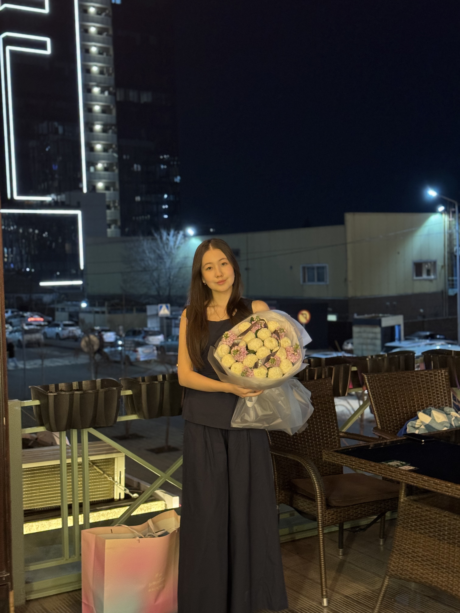

# Introduction
Hi! I'm Kanat Ayanat, a student in the Software Maintenance and Evolution course.

I expect to learn a lot about modern software maintenance practices and how to work with legacy systems.

- **Fun fact**: I don't like to eat tomatoes and drink a coffee
- **Course expectations**: To gain hands-on experience in maintaining and evolving software.

